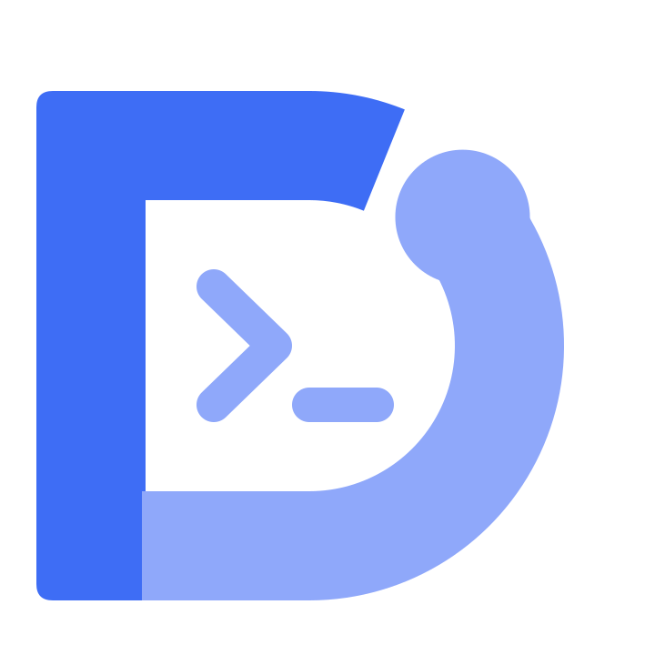
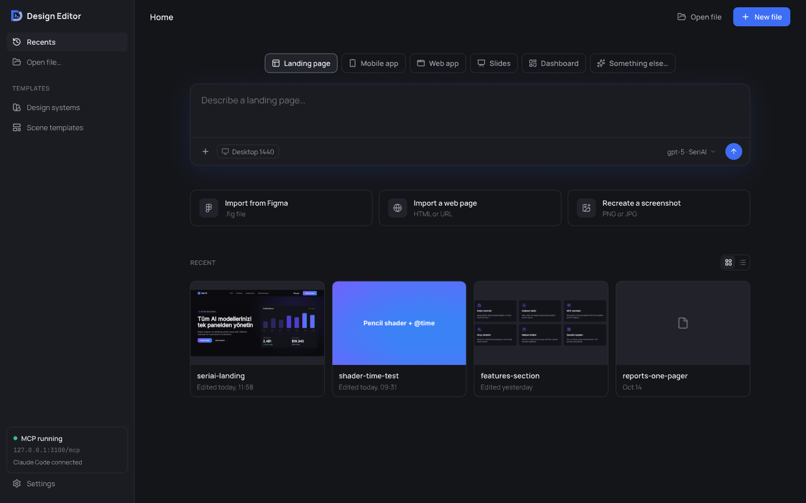
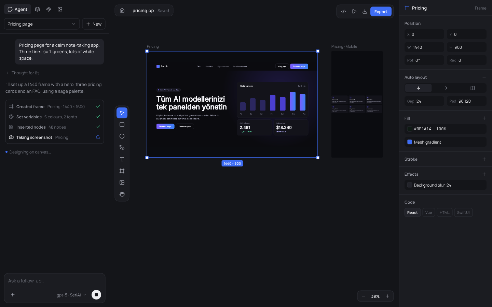

# Design Editor

**A local-first vector design editor where you and AI agents design on the same live canvas.**

[Install](./docs/guide/installation.md) · [Connect an agent](./docs/guide/connect-agents.md) · [In-app chat](./docs/guide/in-app-chat.md) · [CLI](./docs/guide/cli.md) · [Build from source](./docs/guide/building.md)

  

  

- **Agents design live.** A built-in MCP server lets Claude Code and other agents build on the canvas while you watch.
- **Bring your own model.** The in-app chat works with major providers, any OpenAI-compatible endpoint, or agents installed on your machine.
- **Local-first.** No account, no cloud, no telemetry. Rust and Skia, on macOS and Windows.
- **Design as code.** Open `.op` documents, Figma / SVG / web import, export to images, decks and React, SwiftUI, Flutter and more.

## Project

[Roadmap](https://github.com/kemalcalak/design-editor/issues) · [Releases](https://github.com/kemalcalak/design-editor/releases) · [Contributing](./CONTRIBUTING.md) · [Security](./SECURITY.md) · [Skills for agents](https://github.com/kemalcalak/design-editor-skill) · [MIT License](./LICENSE)
