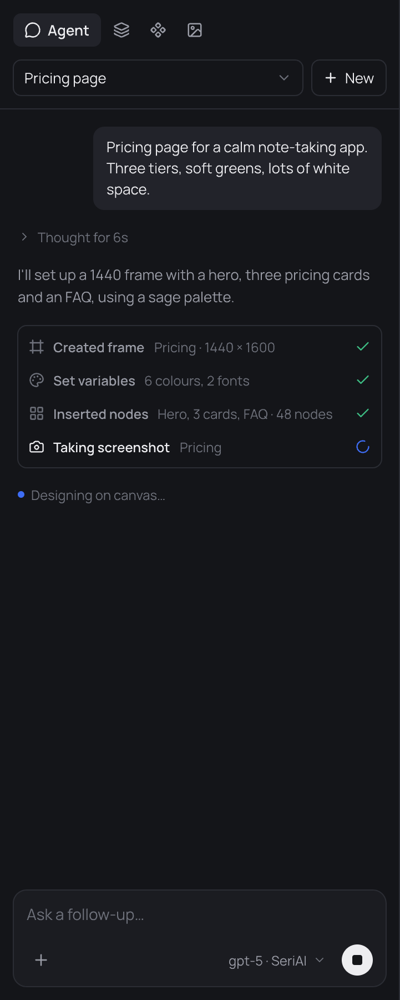

# Design in the app

Open the **Agent** panel, pick a model and describe what you want. The chat lists every tool step the agent takes, and you can stop it at any point.

## Models

- **Providers:** Anthropic, OpenAI, OpenRouter, DeepSeek, Gemini and more. Add a key under **Settings → Agents**.
- **Your own endpoint:** add a **Custom** provider with a base URL, API key and model. The OpenAI-compatible and the Anthropic formats are both supported, so a self-hosted model or an API gateway works like a hosted one.
- **Agents on your machine:** Claude Code, Codex, Copilot, OpenCode and other installed agents can drive the chat too.

Keys stay on your machine and are sent only to the endpoint you configure.

